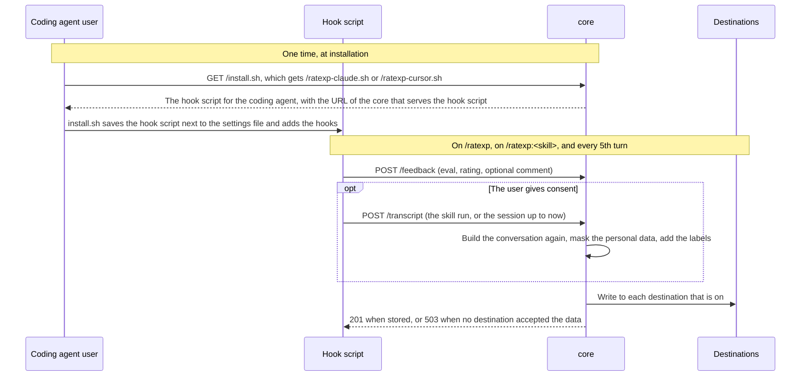
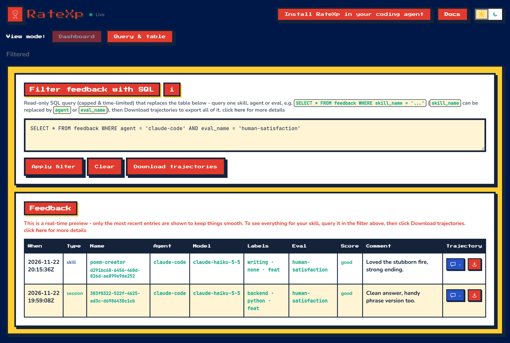

# RateXp
<p align="center">
  
</p>

<p align="center">
  <a href="https://github.com/HikmetB1/RateXp/actions/workflows/ci.yml"></a>
  <a href="https://ratexp-app.azurewebsites.net/"></a>
  <a href="https://ratexp-app.azurewebsites.net/"></a>
  <a href="https://ratexp-core.azurewebsites.net/guide/"></a>
  <a href="./LICENSE"></a>
</p>

<p align="center">
  <a href="#intro">Intro</a> ·
  <a href="#quick-start-install-ratexp">Quick start</a> ·
  <a href="#showcases-ratexp-in-action">Showcases</a> ·
  <a href="#available-human-evals-the-question-of-each-eval">Available human evals</a> ·
  <a href="#how-ratexp-works-from-hook-to-destination">How RateXp works</a> ·
  <a href="#features-what-you-get">Features</a> ·
  <a href="#the-ratexp-app-read-and-export-the-feedback">RateXp app</a> ·
  <a href="#contact-how-to-reach-me">Contact</a> ·
  <a href="#acknowledgements-and-citations-projects-ratexp-builds-on">Acknowledgements</a> ·
  <a href="#license-what-you-may-do-with-ratexp">License</a>
</p>

<a id="intro"></a>
**The problem:**
- Benchmarks and tests measure coding agents and skills, but they do not show whether a real
  session actually helped the human user.
- The person who worked with the agent is seldom asked how the experience felt, so the people
  who can fix the agent or the skill do not know if a session was productive or wasted time.
- The end user often has no meaningful way to describe their pain in their own words to the
  people who can improve the offered solution.

**How RateXp solves the problem:**
- **The concept, human evals:** RateXp collects human evals (human feedback) on the agentic
  experience, from the person who had the experience. Each eval asks specific
  questions with specific objectives: satisfaction, task success, requirement adherence or time
  saved. See [Available human evals](#available-human-evals-the-question-of-each-eval).
- **The vehicle that delivers the human evals, RateXp:** RateXp brings the human eval to the
  user, in the coding agent. The user rates the whole session or a skill that the user ran.
  See [Write adapters](#feature-write-adapters), [Dashboard](#feature-dashboard) and
  [Redaction](#feature-redaction).

**Who RateXp is for:**
- **A company that rolls out a coding agent from a vendor to its employees:**
  - The company gets feedback from real users on real sessions.
  - The company sees the types of work that the employees do with the coding agent, and where
    the employees get good or bad results. See [Labels](#feature-labels).
  - Thus, the company trains the employees where necessary, and tells the vendor what to
    improve.
- **An employee who uses a coding agent or a skill:**
  - The employee tells in seconds what worked and what did not, in the whole session or in
    one run of a skill. See [Session rating](#feature-session-rating) and
    [Skill rating](#feature-skill-rating).
  - The admin or the vendor of the coding agent, or the author of the skill, hears from the
    employee.
- **A person who writes skills for a coding agent:**
  - The skill author sees how people rate the skill in real work, not only in the tests of
    the skill author.

**Easy to adopt:** Run one install command, one time for each coding agent. See
[Quick start](#quick-start-install-ratexp).

<!-- shared:start quick-start -->
## Quick start: install RateXp

**Install RateXp one time in your coding agent:**

<!-- tabs -->
**Claude Code:**

```bash
curl -fsSL https://ratexp-core.azurewebsites.net/install.sh | bash -s -- install claude
```

**Cursor CLI:**

```bash
curl -fsSL https://ratexp-core.azurewebsites.net/install.sh | bash -s -- install cursor
```

- <details><summary><strong>Coding agent settings</strong></summary>

  - **Hook script and settings file:**
    - **Claude Code:** The installer saves the hook script as `~/.claude/ratexp-claude.sh` and
      adds the RateXp hooks to `~/.claude/settings.json`.
    - **Cursor CLI:** The installer saves the hook script as `~/.cursor/ratexp-cursor.sh` and
      adds the RateXp hooks to `~/.cursor/hooks.json`.
  - **Your settings:** The installer does not change the other entries in the settings file.
  - **Backup:** The installer saves a copy of the original settings file as
    `<file>.ratexp-backup`.

  </details>
- **Your own core:** To use your own core in place of the hosted RateXp core, see
  [Custom deploy](./docs/custom-deploy.md).

**To uninstall, to see the status, or to install for one project only, read the installer help:**

```bash
curl -fsSL https://ratexp-core.azurewebsites.net/install.sh | bash -s -- --help
```

### How to give a rating: the commands to type

Each rating answers one eval. See [Human evals](#feature-human-evals).

**To rate the whole session, type:**

```bash
/ratexp
```

**To rate the most recent run of one skill, type:**

```bash
/ratexp:<skill>
```

**To ask a different eval, add the name of the eval to the command:**

```bash
/ratexp <eval>
/ratexp:<skill> <eval>
```

- <strong style="color: #e23a2e">Oh yes, it is annoying to always be asked for a rating.</strong>
  We solved the problem with the `RATEXP_EVERY` parameter. See
  [Session rating](#feature-session-rating).
- **Consent:** RateXp stores a conversation only with consent, and redacts each stored
  conversation. See
  [Transcripts](#feature-transcripts) and [Redaction](#feature-redaction).

<!-- shared:end quick-start -->

## Showcases: RateXp in action

### Session: rate a whole session

1. The user types one prompt in a new Claude Code session.
2. The user types `/ratexp human-satisfaction`.
3. The user answers the eval with True, agrees to store the conversation and adds a comment.
4. The dashboard shows the rating. The trajectory of the rating opens with the full
   conversation.

<p align="center">
  
</p>

### Skill: rate the run of one skill

1. The user runs the skill `/poem-creator` and selects a mood.
2. The user types `/ratexp:poem-creator human-satisfaction`. RateXp asks for a rating of only
   the `poem-creator` skill run, on the `human-satisfaction` eval.
3. The dashboard shows a skill rating. The trajectory contains only the part of the
   conversation that the skill ran.

<p align="center">
  
</p>

<!-- shared:start available-human-evals -->
## Available human evals: the question of each eval

The answer to each eval is **True** or **False**.

| Eval | Question |
|---|---|
| `human-satisfaction` (default) | Overall, are you satisfied and did it meet your expectations? |
| `human-task-success` | Did the agent actually solve what I wanted? |
| `human-requirement-adherence` | Did it follow my instructions and constraints? |
| `human-time-saved` | Did the agent actually make me faster? |

<!-- shared:end available-human-evals -->

<!-- shared:start how-ratexp-works -->
## How RateXp works: from hook to destination

- RateXp core follows these steps to send a human eval value from the user to each destination
  (each write adapter that is on):

  1. core serves the hook script for each coding agent.
  2. core receives the ratings and the conversations that the hook script sends.
  3. core masks the personal data. See [Redaction](#feature-redaction).
  4. core labels each conversation. See [Labels](#feature-labels).
  5. core writes the result to each destination that is on. See
     [Write adapters](#feature-write-adapters).

- **Endpoints:** The hook script sends data only to the `/feedback` and `/transcript` endpoints
  of core. The hook script does not know which destinations core writes to.
- **Skill or session:** core does the same steps for a skill rating and for a session rating.
  Only the part of the conversation is different: the skill run, or the whole session.



<!-- shared:end how-ratexp-works -->

## Features: what you get
1. <a id="feature-install"></a>**Install:** Run one install command one time in the terminal,
   for Claude Code or for Cursor CLI. See [Quick start](#quick-start-install-ratexp).
2. <a id="feature-session-rating"></a>**Session rating:** RateXp asks about all the work in the
   session up to now, when the user types `/ratexp`. RateXp also asks every `RATEXP_EVERY`
   turns, on the default eval. Without `RATEXP_EVERY`, the number of turns is 5. To change the
   number of turns, set `RATEXP_EVERY`, or change `DEFAULT_EVERY` at the top of the saved hook
   script. See [How to give a rating](#how-to-give-a-rating-the-commands-to-type).
3. <a id="feature-skill-rating"></a>**Skill rating:** RateXp asks about only the most recent
   run of the skill, when the user types `/ratexp:<skill>`. See
   [How to give a rating](#how-to-give-a-rating-the-commands-to-type).
4. <a id="feature-human-evals"></a>**Human evals:** Each rating answers one eval, a survey with
   its own question. Without an eval name, RateXp asks the default eval, `human-satisfaction`.
   See [Available human evals](#available-human-evals-the-question-of-each-eval). To change an
   eval or to add a new eval, edit or add one short YAML file in [`core/evals/`](./core/evals/):
   the question and the two answers. See
   [Custom human evals](./docs/human-evals.md#custom-human-evals-copy-the-base-file).
5. <a id="feature-comments"></a>**Comments:** The user selects the eval value, and can add an
   optional comment.
6. <a id="feature-transcripts"></a>**Transcripts:** RateXp stores the conversation of the rated
   run only with the consent of the user. The conversation contains the messages, the
   reasoning, the tool calls and the tool results, in a standard format (ATIF). The hook script
   uploads the conversation directly from the machine of the user. See
   [Redaction](#feature-redaction).
7. <a id="feature-redaction"></a>**Redaction:** core masks the personal data before core stores
   the data. A pluggable adapter masks the data: self-hosted Presidio or Azure AI Language. If
   the adapter fails, core drops the data and does not store the data unmasked.
8. <a id="feature-labels"></a>**Labels:** core gives each stored conversation a business case,
   a main language and a task type. Thus, the trajectories can be put in groups by label.
9. <a id="feature-write-adapters"></a>**Write adapters:** core writes each submission to each
   write adapter that is on. The write adapters work independently: if one write adapter fails,
   the other write adapters continue. See
   [Destinations](#destinations-where-core-writes-the-feedback).
10. <a id="feature-retention"></a>**Retention:** RateXp keeps only the newest ratings and
   their conversations, and deletes the older data automatically. Thus, the storage stays small.
   You set how many ratings stay.
11. <a id="feature-dashboard"></a>**Dashboard:** The dashboard shows the feedback when the
   feedback arrives. The dashboard has panels, a query box and a JSON export. See
   [The RateXp app](#the-ratexp-app-read-and-export-the-feedback).
12. <a id="feature-phone-view"></a>**Phone view:** The RateXp app has a dynamic UI that fits
   the screen when you view the results.

<!-- shared:start destinations -->
## Destinations: where core writes the feedback

core writes each submission to each write adapter that you switch on in
[`core/config.yaml`](./core/config.yaml). RateXp has these write adapters:

- `app_be_psql`: the PostgreSQL database of RateXp
- `custom_psql`: your own PostgreSQL database
- `app_be_dynatrace`: the Dynatrace tenant of RateXp
- `custom_dynatrace`: your own Dynatrace tenant
- `bluebox`: a Bluebox workspace
- `phoenix`: an Arize Phoenix project

<!-- shared:end destinations -->

## Tested: the coding agents and the models

The tests of RateXp ran with these coding agents and models:

| Type | Names and versions |
|------|--------------------|
| Coding agents | Claude Code, Cursor CLI |
| Models | Claude Opus 5.5, 5, 4.8, 4.7, 4.6, 4.5; Claude Sonnet 5.5, 5, 4.6, 4.5; Fable |

## The RateXp app: read and export the feedback
<p align="center">
  
</p>

The [RateXp app](https://ratexp-app.azurewebsites.net/) is one of the destinations: the RateXp
app shows the feedback that core writes with the `app_be_psql` write adapter, when the feedback
arrives. The RateXp app has these views:

- **Dashboard:** panels, filters and **Download trajectories**.
- **Query & table:** the latest ratings, the conversation of each rating, a query box and
  **Download trajectories**.

More than one destination can be on at the same time. core writes the same data to each
destination. See [Destinations](#destinations-where-core-writes-the-feedback) and
[View options](./docs/read-the-feedback.md#view-options-where-to-see-the-human-evals).

For each panel, filter and download, see
[docs/read-the-feedback.md](./docs/read-the-feedback.md).

## Contact: how to reach me
To contact me, send an [email](mailto:hikmet.beyoglu@hotmail.com) or a message on
[LinkedIn](https://www.linkedin.com/in/hikmetb/).

## Acknowledgements and citations: projects RateXp builds on
- **Open-source projects:** RateXp uses open-source projects, and we thank the open-source
  projects. For the licenses and the formal citations of the open-source projects, see
  [THIRD_PARTY_NOTICES.md](./THIRD_PARTY_NOTICES.md).
- **Cite RateXp:** To cite RateXp, use [CITATION.cff](./CITATION.cff).

## License: what you may do with RateXp
RateXp has the [RateXp Source Available License 1.0](./LICENSE). The license is
source-available. RateXp is not open source.

- **Hosted service, free, with no time limit:** Install the hook scripts, and send ratings and
  conversations to the [live dashboard](https://ratexp-app.azurewebsites.net/). One person or
  a full team can use the hosted service, with no data limit. The
  [Terms of Service](./TERMS.md) apply.
- **Your own copy, 30-day trial:** Read, run, change and deploy RateXp on your own machines,
  for personal or internal use. Each person or organization gets one trial. The trial does
  not start again.
- **Commercial license necessary:** You need a commercial license after the trial, for
  production use, to host RateXp for other people, or to build RateXp into a product.
- **Not permitted without written permission:** Do not publish or share the code or a changed
  version of the code. Do not build a competing product. Do not train AI models on the code.
- **Binding text:** This list is a short summary. The [LICENSE](./LICENSE) is the binding text.
- **No warranty:** The software comes **as is, with no warranty**.
- **Commercial license or questions:** [Send me an email](mailto:hikmet.beyoglu@hotmail.com).

---

To run RateXp yourself or to contribute, see the
[docs](https://ratexp-core.azurewebsites.net/guide/) and [CONTRIBUTING.md](./CONTRIBUTING.md).
