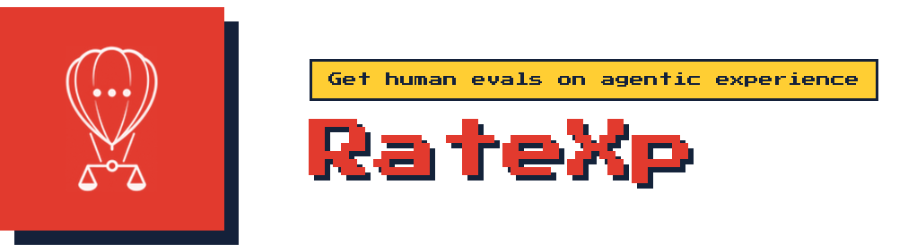
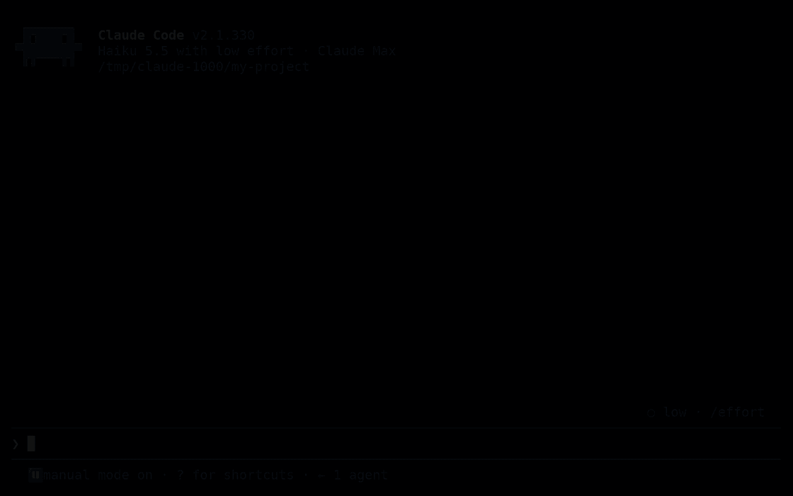
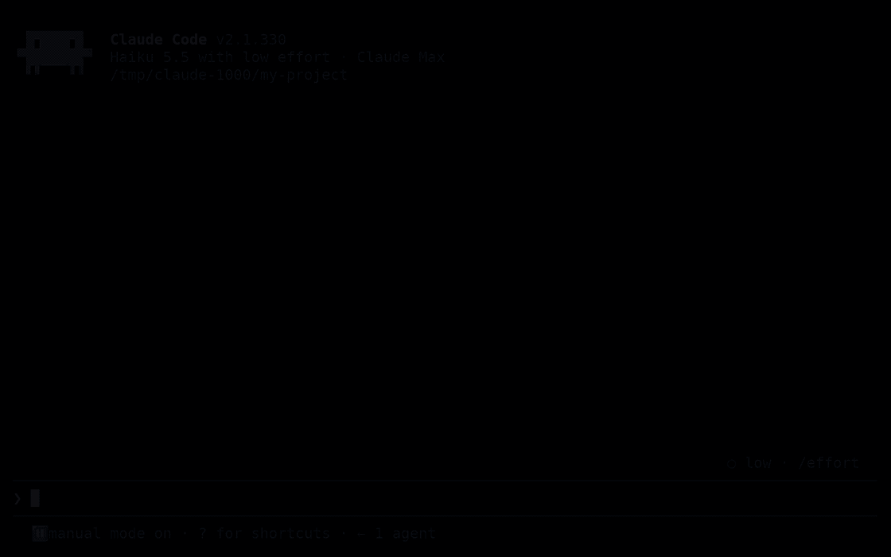
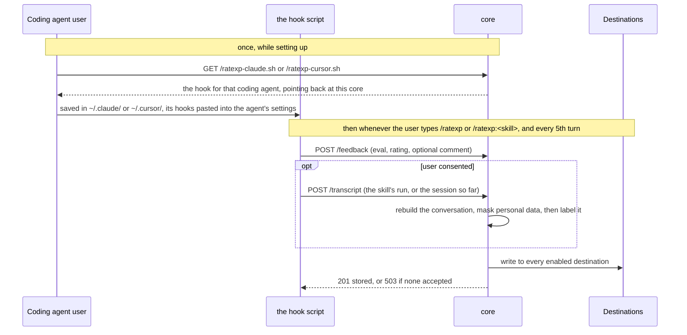

# RateXp
<p align="center">
  
</p>

<p align="center">
  <a href="https://github.com/HikmetB1/RateXp/actions/workflows/ci.yml"></a>
  <a href="https://ratexp-app.azurewebsites.net/"></a>
  <a href="https://ratexp-app.azurewebsites.net/"></a>
  <a href="./LICENSE"></a>
</p>

<p align="center">
  <a href="#intro">Intro</a> ·
  <a href="#showcases-see-it-in-action">Showcases</a> ·
  <a href="#quick-start-install-in-one-command">Quick start</a> ·
  <a href="#available-evals-what-each-one-asks">Available evals</a> ·
  <a href="#how-it-works">How it works</a> ·
  <a href="#features-what-you-get">Features</a> ·
  <a href="#the-ratexp-app-read-and-export-the-feedback">RateXp app</a> ·
  <a href="#contact-how-to-reach-me">Contact</a> ·
  <a href="#acknowledgements-and-citations-projects-ratexp-builds-on">Acknowledgements</a> ·
  <a href="#license-what-you-may-do-with-it">License</a>
</p>

<a id="intro"></a>
**The problem:** coding agents and skills are nowadays measured by benchmarks and tests, but the
person who actually worked with them is rarely asked. Whether the session helped or wasted
their time stays in their head and never reaches the people who could fix it.

**What RateXp does:** it collects **human evals / human feedback on the agentic experience, from the human
who had it**. Right inside the coding agent, the user rates the whole session or any skill
they just ran. The rating - and, if they agree, the conversation with anything personal
masked - lands on the [live dashboard](https://ratexp-app.azurewebsites.net/) or your own
storage.

**Who it is for:**
- **Coding agent users** - say what worked and what did not, in seconds, without leaving
  the session -> stay closer to your coding agemt admin/vendor.
- **Skill authors** - see how people rate your skill in real work, not only in your tests.
- **Coding agent providers** - hear from real users on real sessions. See what kinds of
  work your team use the coding agent for, where they get great results and where they
  struggle - then train them where they need it, and tell the vendor what to improve.

**Easy to adopt:** one download and one paste of hooks, once per coding agent - see the
[Quick start](#quick-start-install-in-one-command).

## Showcases: see it in action

### Session: rate a whole session

A new Claude Code session gets one prompt, then `/ratexp human-satisfaction`. The user answers
that eval with True, agrees to store the conversation and adds a comment - the
rating shows up on the dashboard, and its trajectory opens with the full conversation.

<p align="center">
  
</p>

### Skill: rate one skill's run

The user runs `/poem-creator` and picks a mood, then `/ratexp:poem-creator human-satisfaction`
rates just that run on that eval. The dashboard shows it as a skill rating, with only that
skill's part of the conversation.

<p align="center">
  
</p>

## Quick start: install in one command

Install RateXp once in the coding agent you use - nothing to configure. As of now it works
with Claude Code and Cursor CLI.

```bash
# Pick one

# Claude Code  ->  saves ~/.claude/ratexp-claude.sh, adds its hooks to ~/.claude/settings.json
curl -fsSL https://ratexp-core.azurewebsites.net/install.sh | bash -s -- install claude

# Cursor CLI  ->  saves ~/.cursor/ratexp-cursor.sh, adds its hooks to ~/.cursor/hooks.json
curl -fsSL https://ratexp-core.azurewebsites.net/install.sh | bash -s -- install cursor
```

Everything else in the settings file stays, and a copy of the original settings file is
saved as `<file>.ratexp-backup`.

Uninstall, check the status, or install for one project? The installer's help shows how to do each:

```bash
curl -fsSL https://ratexp-core.azurewebsites.net/install.sh | bash -s -- --help
```

Rather paste the hooks yourself? The [dashboard](https://ratexp-app.azurewebsites.net/)'s
**Install RateXp** popup shows them. That is the whole setup; ratings land on the same
dashboard.

### When it asks: on /ratexp, and every 5th turn

- **The whole session** - whenever you type `/ratexp`, and every 5th turn.
- **How often** - every 5th turn by default; change `DEFAULT_EVERY` at the top of the saved
  script, or set `RATEXP_EVERY`.
- **What is stored** - only with your consent: messages, reasoning, tool calls and their
  results, with personal data masked (redacted) before it is stored.
- **One skill** - type `/ratexp:<skill>` to rate that skill's most recent run.
- **Which eval** - add an eval's name, as in `/ratexp <eval>` or `/ratexp:<skill> <eval>`;
  without one you answer the default, `human-satisfaction`. See
  [Available evals](#available-evals-what-each-one-asks).
- **Tested in** - Claude Code and Cursor CLI.

Want to run your own core instead of the hosted one? See
[Custom deploy](./docs/custom-deploy.md).

## Available evals: what each one asks

Each is answered **True** or **False**.

| Eval | Question |
|---|---|
| `human-satisfaction` (default) | Overall, are you satisfied and did it meet your expectations? |
| `human-task-success` | Did the agent actually solve what I wanted? |
| `human-requirement-adherence` | Did it follow my instructions and constraints? |
| `human-time-saved` | Did the agent actually make me faster? |

## How it works

core hands out the hook script, takes back whatever the hook posts, masks anything personal,
labels each conversation, and writes the result to every destination switched on - the hook
only ever posts to the same two endpoints and never knows where the data ends up. That is true
whether it is rating one skill or the whole session; only how much of the conversation it
covers differs.



## Features: what you get
1. **One install, in your own coding agent** - Claude Code or Cursor CLI, once for every
   project. Nothing has to be built into the skills or the agent you rate.
2. **Rate the session or one skill** - the whole session every 5th turn and on `/ratexp`;
   any skill's most recent run on `/ratexp:<skill>`, the names autocompleting in Claude Code.
3. **Evals: pick the survey** - each eval is one survey with its own wording, such as
   `human-satisfaction`. Whoever runs core adds one as a file in [`core/evals/`](./core/evals/);
   users answer it with `/ratexp <eval>` or `/ratexp:<skill> <eval>`, and every rating keeps the
   name of the eval it answered.
4. **Ratings and comments** - a quick good/bad rating with an optional comment, asked in one
   go - one picker in Claude Code, two short questions in Cursor CLI - so it never gets in the way.
5. **Opt-in transcripts** - only with the user's consent, that run is stored in a standard
   format (ATIF). The hook uploads it straight from the user's machine.
6. **PII redaction** - personal data is masked before storage by a pluggable adapter
   (self-hosted Presidio or Azure AI Language), and dropped rather than stored unmasked.
7. **Trajectory labels** - each stored conversation gets a business case, main language and
   task type, picked by a cheap Azure OpenAI model from lists you set in
   [`core/config.yaml`](./core/config.yaml), so trajectories can be grouped. A model that is
   down only leaves the labels empty.
8. **Write adapters** - storage is an adapter architecture: core writes each submission to
   every adapter you switch on, and they run independently, so one failing never blocks the
   others. Six ship today - `app_be_psql` (RateXp's PostgreSQL), `custom_psql` (your own
   PostgreSQL), `app_be_dynatrace` (RateXp's Dynatrace), `custom_dynatrace` (your own
   Dynatrace), `bluebox` (a Bluebox workspace) and `phoenix` (an Arize Phoenix project).
9. **Live dashboard** - shows feedback as it arrives, with panels, a query box and JSON
   export ([which adapter it reads](./docs/read-the-feedback.md#where-to-find-the-feedback-per-destination)).
10. **Responsive UI** - the table reflows into cards on phones.
11. **Tested models** - Claude Opus (5.5, 5, 4.8, 4.7, 4.6, 4.5), Sonnet (5.5, 5, 4.6, 4.5) and
   Fable.
12. **Tested coding agents** - Claude Code and Cursor CLI

## The RateXp app: read and export the feedback
<p align="center">
  
</p>

The [RateXp app](https://ratexp-app.azurewebsites.net/) updates as feedback arrives and has
two views: **Dashboard** (panels, filters and a trajectory download) and **Query & table** (the
latest ratings, each one's conversation, a query box and a JSON download). The Dashboard view
also comes as a Dynatrace app. What each panel, filter and download does:
[docs/read-the-feedback.md](./docs/read-the-feedback.md).

## Contact: how to reach me
Very glad to be in contact - reach me by [email](mailto:hikmet.beyoglu@hotmail.com) or on
[LinkedIn](https://www.linkedin.com/in/hikmetb/).

## Acknowledgements and citations: projects RateXp builds on
We're grateful to the open-source projects that RateXp leveraged; for their licenses and
formal citations see [THIRD_PARTY_NOTICES.md](./THIRD_PARTY_NOTICES.md). To cite RateXp
itself, use [CITATION.cff](./CITATION.cff).

## License: what you may do with it
[RateXp Source Available License 1.0](./LICENSE) - source-available, not open source.

- **Hosted service - free, no time limit:** install the hook scripts and send ratings and
  conversations to the [live dashboard](https://ratexp-app.azurewebsites.net/), alone or as a
  whole team, with no data limit. The [Terms of Service](./TERMS.md) apply.
- **Your own copy - 30-day trial:** read, run, change and deploy RateXp on your own machines,
  for personal or internal use. One trial per person or organization; it does not restart.
- **Commercial license needed:** after the trial, for production use, to host it for others,
  or to build it into a product.
- **Not allowed without written permission:** publishing or sharing the code or changed
  versions, building a competing product, or training AI models on the code.

This is a short summary; the [LICENSE](./LICENSE) is the binding text. The software comes
**as is, with no warranty**. Commercial license or questions:
[email me here](mailto:hikmet.beyoglu@hotmail.com).

---

Want to run it yourself or contribute? See [docs/](./docs/README.md) and
[CONTRIBUTING.md](./CONTRIBUTING.md).
