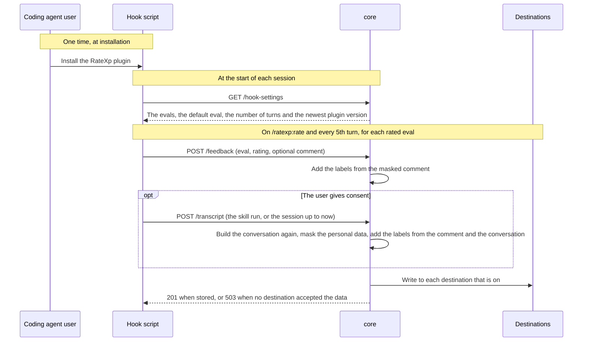
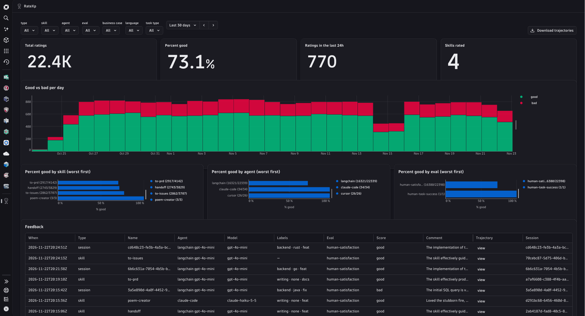

# RateXp
<p align="center">
  
</p>

<p align="center">
  <a href="https://github.com/HikmetB1/RateXp/actions/workflows/ci.yml"></a>
  <a href="https://ratexp-app.azurewebsites.net/"></a>
  <a href="https://ratexp-app.azurewebsites.net/"></a>
  <a href="https://ratexp-core.azurewebsites.net/guide/"></a>
  <a href="./LICENSE"></a>
</p>

<p align="center">
  <a href="#intro">Intro</a> ·
  <a href="#quick-start-install-ratexp">Quick start</a> ·
  <a href="#showcases-ratexp-in-action">Showcases</a> ·
  <a href="#available-human-evals-the-question-of-each-eval">Available human evals</a> ·
  <a href="#how-ratexp-works-from-hook-to-destination">How RateXp works</a> ·
  <a href="#features-what-you-get">Features</a> ·
  <a href="#the-ratexp-dynatrace-app-read-and-export-the-feedback">RateXp Dynatrace app</a> ·
  <a href="#the-ratexp-app-read-and-export-the-feedback">RateXp app</a> ·
  <a href="#contact-how-to-reach-me">Contact</a> ·
  <a href="#acknowledgements-and-citations-projects-ratexp-builds-on">Acknowledgements</a> ·
  <a href="#license-what-you-may-do-with-ratexp">License</a>
</p>

<a id="intro"></a>
**The problem:**
- Benchmarks and tests measure coding agents and skills, but they do not show whether a real
  session actually helped the human user.
- The person who worked with the agent is seldom asked how the experience felt, so the people
  who can fix the agent or the skill do not know if a session was productive or wasted time.
- The end user often has no meaningful way to describe their pain in their own words to the
  people who can improve the offered solution.

**How RateXp solves the problem:**
- **The concept, human evals:** RateXp collects human evals (human feedback) on the agentic
  experience, from the person who had the experience. Each eval asks specific
  questions with specific objectives: satisfaction, task success, requirement adherence or time
  saved. See [Available human evals](#available-human-evals-the-question-of-each-eval).
- **The vehicle that delivers the human evals, RateXp:** RateXp brings the human eval to the
  user, in the coding agent. The user rates the whole session or a skill that the user ran.
  See [Write adapters](#feature-write-adapters), [Dashboard](#feature-dashboard) and
  [Redaction](#feature-redaction).

**Who RateXp is for:**
- **A company that rolls out a coding agent from a vendor to its employees:**
  - The company gets feedback from real users on real sessions.
  - The company sees the types of work that the employees do with the coding agent, where
    the employees get good or bad results, and what the employees praise or complain about.
    See [Labels](#feature-labels).
  - Thus, the company trains the employees where necessary, and tells the vendor what to
    improve.
- **An employee who uses a coding agent or a skill:**
  - The employee tells in seconds what worked and what did not, in the whole session or in
    one run of a skill. See [Session rating](#feature-session-rating) and
    [Skill rating](#feature-skill-rating).
  - The admin or the vendor of the coding agent, or the author of the skill, hears from the
    employee.
- **A person who writes skills for a coding agent:**
  - The skill author sees how people rate the skill in real work, not only in the tests of
    the skill author.

**Easy to adopt:** Install the RateXp plugin one time for each coding agent. See
[Quick start](#quick-start-install-ratexp).

<!-- shared:start quick-start -->
## Quick start: install RateXp

Install the RateXp plugin one time. Do the steps for your coding agent.

**Claude Code:**

1. **Install the plugin:** Type one of these commands in the terminal. For one repository,
   type the command in the folder of the repository.

   <!-- tabs -->
   **All your projects:**

   ```bash
   claude plugin install ratexp --marketplace https://raw.githubusercontent.com/HikmetB1/RateXp/main/.claude-plugin/marketplace.json
   ```

   **One repository:**

   ```bash
   claude plugin install ratexp --marketplace https://raw.githubusercontent.com/HikmetB1/RateXp/main/.claude-plugin/marketplace.json --scope local
   ```

2. **Start Claude Code:** `/ratexp:rate` works. If Claude Code is open, type
   `/reload-plugins` in Claude Code.

**Cursor CLI:**

1. **Add the RateXp marketplace:** Type this command in the terminal:

   ```bash
   agent plugin marketplace add https://github.com/HikmetB1/RateXp
   ```

2. **Install the plugin:** Start the Cursor CLI with `agent` and type `/plugin`. Press → to
   open Marketplace, type `ratexp` and press Enter. Then pick the tab that fits:

   <!-- tabs -->
   **All your projects:**

   Pick **Install for you**.

   **One repository:**

   Pick **Install for all collaborators on this repository** (shared with everyone on the
   repository).

3. **Restart the Cursor CLI:** Exit the Cursor CLI and start the Cursor CLI again. Then
   `/ratexp:rate` works. The survey every 5 turns starts from your next Cursor CLI session.

**After the install:**

- **Rate:** Type `/ratexp:rate`. See
  [How to give a rating](#how-to-give-a-rating-the-command-and-the-survey).
- **Cursor hooks file:** The plugin changes `~/.cursor/hooks.json` and keeps a copy of your
  old file as `~/.cursor/hooks.json.ratexp-backup`.
- **Updates:** When a newer version of the plugin is available, RateXp shows a message that
  tells how to update.

### How to give a rating: the command and the survey

Type this command in the coding agent:

```bash title="Coding agent session"
/ratexp:rate
```

The survey then asks these questions:

- **Eval what:** The whole session, the most recent run of the last skill that ran, or
  both. See [Session rating](#feature-session-rating) and [Skill rating](#feature-skill-rating).
- **Evals:** True or False for each eval that you want to rate. The survey shows what True and
  what False mean for each eval. RateXp skips an eval that has no True or False. See
  [Human evals](#feature-human-evals).
- **Store trajectory:** Yes or no. With yes, RateXp stores the conversation of each rating.
- **Comment:** One optional comment. RateXp stores the comment with each rating.

RateXp then stores one rating for each eval that you rated, for each part that you rated.

- **Claude Code:** The survey is a RateXp panel, with the tabs **Eval what**, **Evals**,
  **Store** and **Comment**, and the buttons **Send** and **Skip**. The up and down arrows,
  Enter, the keys 1 to 4 and the mouse work in the panel. Past the last choice of a tab, the
  down arrow goes to the next tab. With nothing ticked under **Eval what**, the other tabs
  and **Send** are struck through, and the down arrow goes to **Skip**. The panel needs Claude Code v2.1.287 or
  later with mods on. Without a panel, Claude Code asks the default eval about the whole
  session.
- **Cursor CLI:** The agent asks the same questions in one question menu. The Cursor CLI
  also accepts `/ratexp` in place of `/ratexp:rate`.
- <strong style="color: #e23a2e">Oh yes, it is annoying to always be asked for a rating.</strong>
  <strong style="color: #0f9b67">We solved the problem 😉 with the `RATEXP_EVERY` parameter.</strong>
   See
  [Session rating](#feature-session-rating).
- **Consent:** RateXp stores a conversation only with consent, and redacts each stored
  conversation. See
  [Transcripts](#feature-transcripts) and [Redaction](#feature-redaction).

<!-- shared:end quick-start -->

## Showcases: RateXp in action

### Session: rate a whole session

1. The user types one prompt in a new Claude Code session.
2. The user types `/ratexp:rate`.
3. In the survey, the user selects the session, answers the `human-satisfaction` eval with
   True, agrees to store the conversation and adds a comment.
4. The dashboard shows the rating. The trajectory of the rating opens with the full
   conversation.

<p align="center">
  
</p>

### Skill: rate the run of one skill

1. The user runs the skill `/poem-creator` and selects a mood.
2. The user types `/ratexp:rate`. In the survey, the user selects the last skill,
   `poem-creator`, and answers the `human-satisfaction` eval.
3. The dashboard shows a skill rating. The trajectory contains only the part of the
   conversation that the skill ran.

<p align="center">
  
</p>

<!-- shared:start available-human-evals -->
## Available human evals: the question of each eval

The answer to each eval is **True** or **False**.

| Eval | Question |
|---|---|
| `human-satisfaction` (default) | Overall, are you satisfied and did it meet your expectations? |
| `human-task-success` | Did the agent actually solve what I wanted? |
| `human-requirement-adherence` | Did it follow my instructions and constraints? |
| `human-time-saved` | Did the agent actually make me faster? |

<!-- shared:end available-human-evals -->

<!-- shared:start how-ratexp-works -->
## How RateXp works: from hook to destination

- RateXp core follows these steps to send a human eval value from the user to each destination
  (each write adapter that is on):

  1. core sends the evals and the number of turns to the hook script of the plugin.
  2. core receives the ratings and the conversations that the hook script sends.
  3. core masks the personal data. See [Redaction](#feature-redaction).
  4. core labels each rating and each conversation. See [Labels](#feature-labels).
  5. core writes the result to each destination that is on. See
     [Write adapters](#feature-write-adapters).

- **Endpoints:** The hook script sends data only to the `/feedback` and `/transcript` endpoints
  of core. The hook script does not know which destinations core writes to.
- **Settings from core:** At the start of each session, the hook script reads the evals, the
  default eval, the number of turns and the newest plugin version from `/hook-settings`.
- **Cursor hooks file:** Cursor runs the stop hook of a plugin only when `~/.cursor/hooks.json`
  also has a stop hook. If that file has no stop hook, the plugin adds a stop hook that does
  nothing, and keeps a copy of the old file as `hooks.json.ratexp-backup`.
- **Skill or session:** core does the same steps for a skill rating and for a session rating.
  Only the part of the conversation is different: the skill run, or the whole session.



<!-- shared:end how-ratexp-works -->

## Features: what you get
1. <a id="feature-install"></a>**Install:** Install the RateXp plugin one time, in Claude Code
   or in the Cursor CLI, for all of your projects or for one project. See
   [Quick start](#quick-start-install-ratexp).
2. <a id="feature-session-rating"></a>**Session rating:** A session rating covers all the
   work in the session up to now. RateXp asks when the user types `/ratexp:rate`, and also
   every `RATEXP_EVERY` turns. Without `RATEXP_EVERY`, the number of turns is the number that
   core sets: 5. To change the number of turns, set `RATEXP_EVERY`. See
   [How to give a rating](#how-to-give-a-rating-the-command-and-the-survey).
3. <a id="feature-skill-rating"></a>**Skill rating:** A skill rating covers only the most
   recent run of the last skill that ran. The user selects the skill in the survey, alone or
   with the session. See
   [How to give a rating](#how-to-give-a-rating-the-command-and-the-survey).
4. <a id="feature-human-evals"></a>**Human evals:** Each rating answers one eval, a survey with
   its own question. The user answers as many evals as the user wants in one survey. Where
   Claude Code has no rating panel, RateXp asks the default eval, `human-satisfaction`.
   See [Available human evals](#available-human-evals-the-question-of-each-eval). To change an
   eval or to add a new eval, edit or add one short YAML file in [`core/evals/`](./core/evals/):
   the question and the two answers. See
   [Custom human evals](./docs/human-evals.md#custom-human-evals-copy-the-base-file).
5. <a id="feature-central-settings"></a>**Central settings:** The admin of core sets the evals,
   the default eval and the number of turns for all users of the plugin. Each user gets a
   change at the start of the next session, with no new install. Each user can still change
   two values: `RATEXP_EVERY` sets the number of turns, and `RATEXP_URL` sets the core that
   gets the ratings.
6. <a id="feature-comments"></a>**Comments:** The user selects the eval values, and can add one
   optional comment. RateXp stores the comment with each rating of the survey.
7. <a id="feature-transcripts"></a>**Transcripts:** RateXp stores the conversation of the rated
   run only with the consent of the user. The conversation contains the messages, the
   reasoning, the tool calls and the tool results, in a standard format (ATIF). The hook script
   uploads the conversation directly from the machine of the user. See
   [Redaction](#feature-redaction).
8. <a id="feature-redaction"></a>**Redaction:** core masks the personal data before core stores
   the data. A pluggable adapter masks the data: self-hosted Presidio or Azure AI Language. If
   the adapter fails, core drops the data and does not store the data unmasked.
9. <a id="feature-labels"></a>**Labels:** core assigns a label to each rating and stored conversation,
   based on every label group. The admin defines the label groups and their possible values in
   `core/config.yaml`. This lets you organize ratings and conversations into labeled groups.
10. <a id="feature-write-adapters"></a>**Write adapters:** core writes each submission to each
   write adapter that is on. The write adapters work independently: if one write adapter fails,
   the other write adapters continue. See
   [Destinations](#destinations-where-core-writes-the-feedback).
11. <a id="feature-retention"></a>**Retention:** RateXp keeps only the newest ratings and
   their conversations, and deletes the older data automatically. Thus, the storage stays small.
   You set how many ratings stay.
12. <a id="feature-dashboard"></a>**Dashboard:** The dashboard shows the feedback when the
   feedback arrives. The dashboard has panels, a query box and a JSON export. See
   [The RateXp app](#the-ratexp-app-read-and-export-the-feedback).
13. <a id="feature-phone-view"></a>**Phone view:** The RateXp app has a dynamic UI that fits
   the screen when you view the results.

<!-- shared:start destinations -->
## Destinations: where core writes the feedback

core writes each submission to each write adapter that you switch on in
[`core/config.yaml`](./core/config.yaml). RateXp has these write adapters:

- `app_be_psql`: the PostgreSQL database of RateXp
- `custom_psql`: your own PostgreSQL database
- `app_be_dynatrace`: the Dynatrace tenant of RateXp
- `custom_dynatrace`: your own Dynatrace tenant
- `bluebox`: a Bluebox workspace
- `phoenix`: an Arize Phoenix project

<!-- shared:end destinations -->

## Tested agents and models: what the tests of RateXp ran with

The tests of RateXp ran with these coding agents and models:

| Type | Names and versions |
|------|--------------------|
| Coding agents | Claude Code, Cursor CLI |
| Models | Claude Opus 5.5, 5, 4.8, 4.7, 4.6, 4.5; Claude Sonnet 5.5, 5, 4.6, 4.5; Claude Haiku 5.5, 4.5; Fable |

## The RateXp Dynatrace app: read and export the feedback
<p align="center">
  
</p>

The [RateXp Dynatrace app](./app/dynatrace/README.md) is one of the destinations: the RateXp
Dynatrace app shows the feedback that core writes with the `app_be_dynatrace` write adapter,
when the feedback arrives. The RateXp Dynatrace app has this view:

- **Dashboard:** panels, filters, a time range and **Download trajectories**.

See [Destinations](#destinations-where-core-writes-the-feedback) and
[View options](./docs/read-the-feedback.md#view-options-where-to-see-the-human-evals).

For each panel, filter and download, see
[docs/read-the-feedback.md](./docs/read-the-feedback.md).

## The RateXp app: read and export the feedback
<p align="center">
  
</p>

The [RateXp app](https://ratexp-app.azurewebsites.net/) is one of the destinations: the RateXp
app shows the feedback that core writes with the `app_be_psql` write adapter, when the feedback
arrives. The RateXp app has these views:

- **Dashboard:** panels, filters and **Download trajectories**.
- **Query & table:** the latest ratings, the conversation of each rating, a query box and
  **Download trajectories**.

More than one destination can be on at the same time. core writes the same data to each
destination. See [Destinations](#destinations-where-core-writes-the-feedback) and
[View options](./docs/read-the-feedback.md#view-options-where-to-see-the-human-evals).

For each panel, filter and download, see
[docs/read-the-feedback.md](./docs/read-the-feedback.md).

## Contact: how to reach me
To contact me, send an [email](mailto:hikmet.beyoglu@hotmail.com) or a message on
[LinkedIn](https://www.linkedin.com/in/hikmetb/).

## Acknowledgements and citations: projects RateXp builds on
- **Open-source projects:** RateXp uses open-source projects, and we thank the open-source
  projects. For the licenses and the formal citations of the open-source projects, see
  [THIRD_PARTY_NOTICES.md](./THIRD_PARTY_NOTICES.md).
- **Cite RateXp:** To cite RateXp, use [CITATION.cff](./CITATION.cff).

## License: what you may do with RateXp
RateXp has the [RateXp Source Available License 1.0](./LICENSE). The license is
source-available. RateXp is not open source.

- **Hosted service, free, with no time limit:** Install RateXp, and send ratings and
  conversations to the [live dashboard](https://ratexp-app.azurewebsites.net/). One person or
  a full team can use the hosted service, with no data limit. The
  [Terms of Service](./TERMS.md) apply.
- **Your own copy, 30-day trial:** Read, run, change and deploy RateXp on your own machines,
  for personal or internal use. Each person or organization gets one trial. The trial does
  not start again.
- **Commercial license necessary:** You need a commercial license after the trial, for
  production use, to host RateXp for other people, or to build RateXp into a product.
- **Not permitted without written permission:** Do not publish or share the code or a changed
  version of the code. Do not build a competing product. Do not train AI models on the code.
- **Binding text:** This list is a short summary. The [LICENSE](./LICENSE) is the binding text.
- **No warranty:** The software comes **as is, with no warranty**.
- **Commercial license or questions:** [Send me an email](mailto:hikmet.beyoglu@hotmail.com).

---

To run RateXp yourself or to contribute, see the
[docs](https://ratexp-core.azurewebsites.net/guide/) and [CONTRIBUTING.md](./CONTRIBUTING.md).
